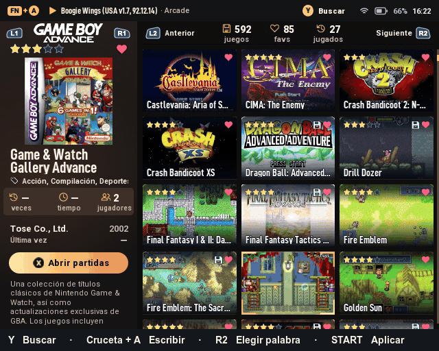

# Canica para la Anbernic RG35XX H

Canica usa mi fork de EmulationStation sobre KNULLI Scarab. Agrupa las consolas por categoría, permite buscar con la cruceta y separa **A · Jugar** de **X · Partidas**. Iris y Ámbar comparten los mismos controles.

**Para replicar mi consola necesitas el kit de Canica para la RG35XX H.** La guía explica qué archivo copiar, cómo reconocer el menú correcto y cómo volver al anterior. El motor y el instalador son públicos. El tema y su arte se entregan por separado. [Instalación en la RG35XX H](docs/canica-rg35xx-h.md)

[Ver la galería de controles, partidas, vistas previas y ajustes](docs/canica-en-accion.md)

## Qué aporta este fork

| Componente | Repositorio y función |
| --- | --- |
| Firmware y partidas | [Firmware en `main`](https://github.com/eduarbo/knulli-linux/tree/main) · receta H700, preparación del kit y adaptador |
| Menú que ejecuta el tema | [Fork de EmulationStation](https://github.com/eduarbo/batocera-emulationstation) · tarjetas, navegación, vídeo y búsqueda con cruceta |
| Herramientas para Scarab | [knulli-console-bundles](https://github.com/eduarbo/knulli-console-bundles) · compilación ARM64, servicio reversible y paquetes de correcciones |

**Diferencia frente a Scarab.** La serie `ff02e3d` contiene nueve commits sobre el tag oficial `20260511`, con cambios de suspensión y batería, DraStic, ajustes por juego y Wi-Fi. La integración de Canica `f6a4e9e` acumula **12 commits y 18 archivos modificados** desde ese mismo tag. Los tres posteriores añaden la integración para H700, el instalador desde fuentes, su documentación y el adaptador. La imagen de partida para la instalación documentada es la oficial de la RG35XX H. [Diff de estas revisiones](https://github.com/eduarbo/knulli-linux/compare/c1c7de479e56691c6665723046d9f25500e5ee74...f6a4e9ed39c6cc49c6f5eecbcf08c22a6020ff3a) · [PR de integración](https://github.com/eduarbo/knulli-linux/pull/1)

## Proyecto KNULLI original

## :video_game::penguin: Knulli CFW :video_game::penguin:
Knulli CFW is a fork of the open-source and completely free retro-gaming distribution batocera that can be copied to an SD card with the aim of improving many of the emulation handhelds on the market that usually ship with incomplete and often non GPL compliant software. It supports [many emulators and game engines](https://www.batocera.org/compatibility.php) out of the box. 

## Get information on the project

 - :globe_with_meridians: Browse our [website](https://knulli.org) for general information (Downloads coming soon)
 - :memo: Documentation is available on our [wiki](https://knulli.org) and frequently updated
 - :speech_balloon: Discuss any topic with the community on our [Discord Server](https://discord.gg/HXPS3DAeeB)

## Do you need help with KNULLI?

 - :sos: The most effective way is to join our [Discord Server](https://discord.gg/HXPS3DAeeB) and go to the \#questions channel

## How can you help Knulli?

 - :wrench: If you want to help with development, [we accept PRs](https://makeapullrequest.com/) -- anyone is welcome, we embrace the [Bazaar development principles](https://en.wikipedia.org/wiki/The_Cathedral_and_the_Bazaar)

## Directory navigation

 - `board` Platform-specific build configuration. This is where to include special patches/configuration files needed to have particular components work on a particular platform. It is instead encouraged to apply patches at the location of the package itself, but this may not always be possible.
 - `buildroot` Buildroot, the tool used to create the final compiled images. For newcomers, you can safely ignore this folder. Compilation instructions can be found [on the wiki](https://wiki.batocera.org/compile_knulli.linux).
 - `configs` Build flags, which define what components will be built with your image depending on your chose architecture. If you're trying to port Batocera to a new architecture (device, platform, new bit mode, etc.) this is the file you'll need to edit. More information on [the build configuration section on the buildroot compiling page](https://wiki.batocera.org/knulli.linux_buildroot_modifications#define_your_configuration).
 - `package` The "meat and potatoes" of Batocera. This is where the majority of emulator data, config generators, core packages, system utilities, etc. all go into. This is the friendliest place to start dev-work for new devs, as most of it is handled by Python and Makefile.
 - `scripts` Various miscellanous scripts that handle aspects external to Batocera, such as the report data sent to the [compatibility page](https://batocera.org/compatibility.php) or info about the Bezel Project.

A cheatsheet of notable files/folders can be found [on the wiki](https://wiki.batocera.org/notable_files).
