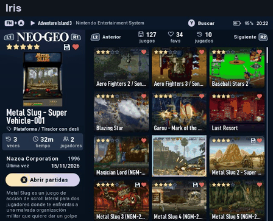
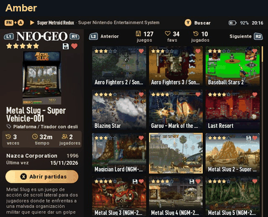
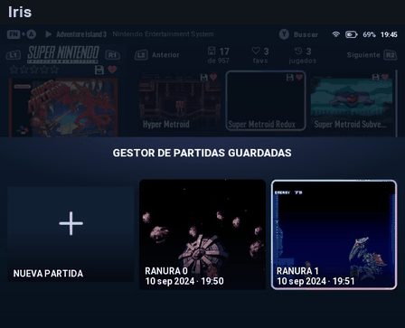
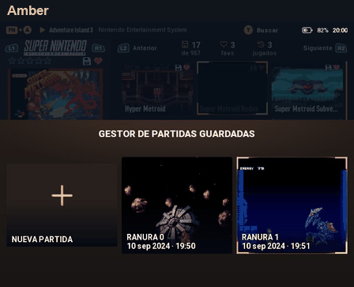

# Canica for the Anbernic RG35XX H

Browse by console, watch a game inside its card, and pick up from a save you recognize. Real footage from my RG35XX H.

 

The selected card plays the Neo Geo run-and-gun in the library.

[Install Canica RC30](docs/canica-rg35xx-h.md) · [Watch all the demos](docs/canica-en-accion.md) · [Bring your own ROMs](docs/canica-rg35xx-h.md#bring-your-own-roms) · [My RomM and TV setup](docs/canica-rg35xx-h.md#from-the-handheld-to-a-tv-with-romm)

## Find a game. Pick a save.

 

Move between slots 0 and 1. The screenshot, slot number and save time distinguish the two saves made one minute apart.

## From my handheld to my TVs

I sync my handheld library and saves with RomM. My custom TV launchers include a game browser backed by the same library, so I can pick a game on the couch and carry on from a compatible in-game save. Canica runs locally on the handheld. The RomM sync client and TV launchers are separate parts of my setup. [How the handoff works](docs/canica-rg35xx-h.md#from-the-handheld-to-a-tv-with-romm)

## What you need

Canica RC30 pairs the May 11, 2026 KNULLI Scarab image for the **RG35XX H** with my EmulationStation fork, save adapter and theme. Get the theme kit separately; its artwork license is pending. The public installer accepts that kit. The guide covers setup, controls and how to restore the original menu. [Install and verify](docs/canica-rg35xx-h.md) · [Build the frontend](tools/canica/README.md)

This firmware fork carries the H700 integration and save adapter. The [frontend fork](https://github.com/eduarbo/batocera-emulationstation) implements the cards, navigation and search. The [build tools](https://github.com/eduarbo/knulli-console-bundles) provide the ARM64 build and recovery scripts. At `ff02e3d` the firmware had nine commits beyond Scarab, covering suspend, battery, DraStic, per-game settings and Wi-Fi. At integration revision `f6a4e9e`, the difference was 12 commits across 18 files. [Pinned firmware comparison](https://github.com/eduarbo/knulli-linux/compare/c1c7de479e56691c6665723046d9f25500e5ee74...f6a4e9ed39c6cc49c6f5eecbcf08c22a6020ff3a) · [Integration PR](https://github.com/eduarbo/knulli-linux/pull/1)

## Upstream KNULLI

## :video_game::penguin: Knulli CFW :video_game::penguin:
Knulli CFW is a fork of the open-source and completely free retro-gaming distribution batocera that can be copied to an SD card with the aim of improving many of the emulation handhelds on the market that usually ship with incomplete and often non GPL compliant software. It supports [many emulators and game engines](https://www.batocera.org/compatibility.php) out of the box. 

## Get information on the project

 - :globe_with_meridians: Browse our [website](https://knulli.org) for general information (Downloads coming soon)
 - :memo: Documentation is available on our [wiki](https://knulli.org) and frequently updated
 - :speech_balloon: Discuss any topic with the community on our [Discord Server](https://discord.gg/HXPS3DAeeB)

## Do you need help with KNULLI?

 - :sos: The most effective way is to join our [Discord Server](https://discord.gg/HXPS3DAeeB) and go to the \#questions channel

## How can you help Knulli?

 - :wrench: If you want to help with development, [we accept PRs](https://makeapullrequest.com/) -- anyone is welcome, we embrace the [Bazaar development principles](https://en.wikipedia.org/wiki/The_Cathedral_and_the_Bazaar)

## Directory navigation

 - `board` Platform-specific build configuration. This is where to include special patches/configuration files needed to have particular components work on a particular platform. It is instead encouraged to apply patches at the location of the package itself, but this may not always be possible.
 - `buildroot` Buildroot, the tool used to create the final compiled images. For newcomers, you can safely ignore this folder. Compilation instructions can be found [on the wiki](https://wiki.batocera.org/compile_knulli.linux).
 - `configs` Build flags, which define what components will be built with your image depending on your chose architecture. If you're trying to port Batocera to a new architecture (device, platform, new bit mode, etc.) this is the file you'll need to edit. More information on [the build configuration section on the buildroot compiling page](https://wiki.batocera.org/knulli.linux_buildroot_modifications#define_your_configuration).
 - `package` The "meat and potatoes" of Batocera. This is where the majority of emulator data, config generators, core packages, system utilities, etc. all go into. This is the friendliest place to start dev-work for new devs, as most of it is handled by Python and Makefile.
 - `scripts` Various miscellanous scripts that handle aspects external to Batocera, such as the report data sent to the [compatibility page](https://batocera.org/compatibility.php) or info about the Bezel Project.

A cheatsheet of notable files/folders can be found [on the wiki](https://wiki.batocera.org/notable_files).
