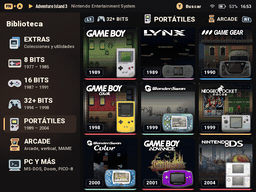
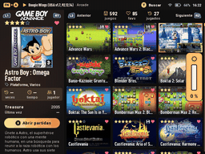
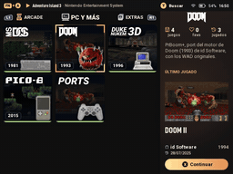
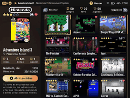
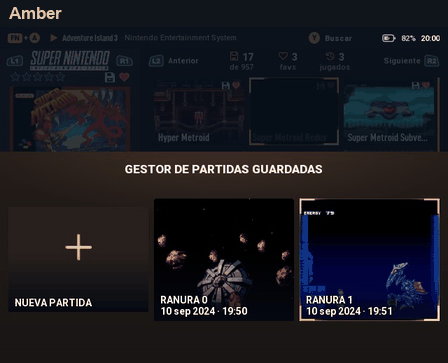
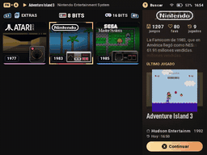
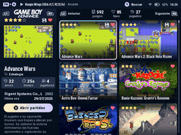
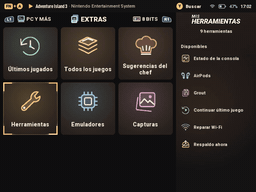
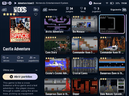
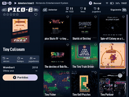

# Canica in action

[Home](../README.md) · [Install on the RG35XX H](canica-rg35xx-h.md)

Captured on my RG35XX H with the handheld set to Spanish. **Iris is on the left, Amber on the right.** Each GIF opens independently at 640 × 480. The two runs use the same compact cards, cover art in the details panel and in-card video. The settings demo shows the other options.

[Browse](#browse-the-library) · [Discover](#find-the-next-game) · [Play and save](#start-a-game-or-pick-a-save) · [Customize](#make-the-handheld-your-own) · [More game cards](#four-more-game-cards)

## Browse the library

### Battle Garegga in portrait

Watch the screenshot give way to a vertical arcade video inside its card.

### From Game Boy to Nintendo DS

Browse handheld shelves, their library totals and their playing history.

### Super Metroid Redux · in-card video

 

Move the selection back to Super Metroid Redux. Watch the card markers fade as the video starts.

### Console categories

Press L1 or R1 on Home to change categories. Press Right to focus the console cards.

### Change systems and pages

In a game list, L1 and R1 switch consoles. L2 and R2 turn the page.

### Jump by initial

Hold L2 or R2 in a list sorted by name to jump between initials.

### Complete words with the D-pad

Press Y to search. L2 inserts the first suggestion. R2 focuses the row, the D-pad chooses a word and A inserts it. START applies the filter.

### A shelf of PICO-8 cartridges

Automatic grid sizing keeps PICO-8 in three columns.

### Mark a favorite

Hold A and choose the favorite action. The heart and the library count update together.

## Find the next game

### The Simpsons in Chef’s Picks

A favorite arcade game gives way to another favorite from the Famicom Disk System.

### All Games across systems

The panel switches to another game when its preview ends and names the console.

### Adventure Island III to The Punisher

The Nintendo shelf rotates through games you have played. X launches the one in the panel.

### Recently Played

History starts with the most recent game and advances when the clip ends.

### Three collections, one panel

Recently Played, All Games and Chef’s Picks identify both the selected game and its system.

### Ports and Duke Nukem 3D

Ports draws its background from the collection. Duke Nukem uses its own game art.

## Start a game or pick a save

### Super Metroid Redux · open the save slots

 

Press X on Super Metroid Redux to see two SNES saves with different scenes, each dated September 10, 2024.

### Back to Oak Forest

A resumes Adventure Island III at the item screen for area 1-3.

### Super Metroid Redux · compare saved scenes

 

Move between slots 0 and 1. The screenshot, slot number and save time distinguish the two saves made one minute apart.

### Resume from Home

Hold FN and press A to launch the last game shown beside the play symbol.

### Continue from a console shelf

X on the Nintendo panel launches the game it is showing.

### Launch Ascent with A

A starts the PICO-8 game directly. The wait between the menu and the game has been shortened in this recording.

### Games with their own save system

The slot picker explains when a system relies on saves made inside the game.

## Make the handheld your own

### Dragon Ball on the fullscreen viewer

Open the game’s media viewer and use the D-pad to browse full-size images.

### Screenshots in Extras

Open Screenshots, press A for the full image and use the D-pad to move between shots.

### Five theme settings

Choose a palette, card density, card video behavior, detail image and console preview behavior.

### Volume and brightness

The volume buttons bring up the side meter. Hold FN with the volume buttons to change brightness.

### Tools and emulators

The side panel lists available shortcuts. Press A to open the grid.

## Four more game cards

### Castle Adventure · MS-DOS

The selected card plays the DOS capture.

### QBasic Nibbles · MS-DOS

Watch the snake move inside the selected card.

### Kiloblaster · MS-DOS

The DOS shooter runs in the preview while the library stays visible.

### Tiny Coliseum · PICO-8

The PICO-8 preview plays inside the square cartridge grid.
