# Canica en acción

Tomas de la pantalla de mi Anbernic RG35XX H a 640 × 480 con el frontend de Canica. El pie bajo cada GIF identifica el control. Abre una demostración para verla. [Instalación y vuelta al menú anterior](canica-rg35xx-h.md)

## Biblioteca y consolas

Categorías con L1 y R1

En Inicio cambia de categoría. Pulsa derecha para enfocar sus tarjetas.

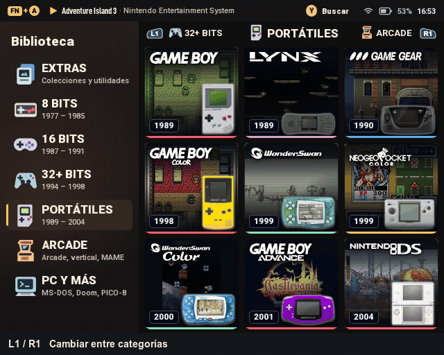

Las tarjetas de cada consola

La ficha reúne el catálogo, los favoritos, los juegos jugados y el historial del sistema seleccionado.

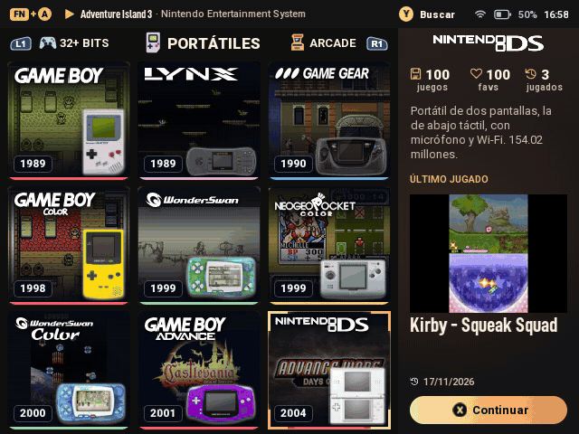

Historial de una consola

La ficha de Nintendo pasa de Adventure Island 3 a The Punisher al terminar el vídeo. X abre el juego visible.

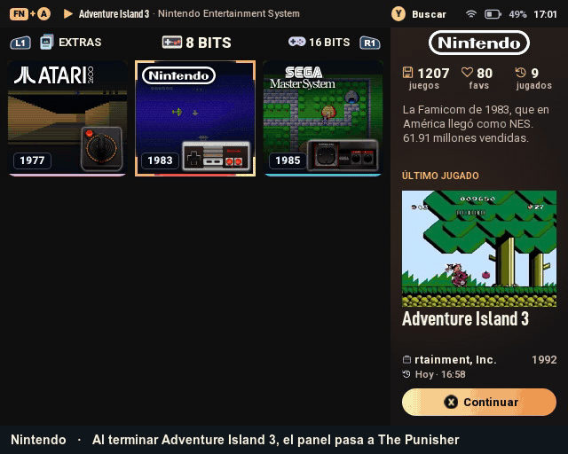

Fondos de Ports y Duke Nukem 3D

El fondo de Ports se toma de un juego de la colección. Duke usa las capturas de su propio catálogo.

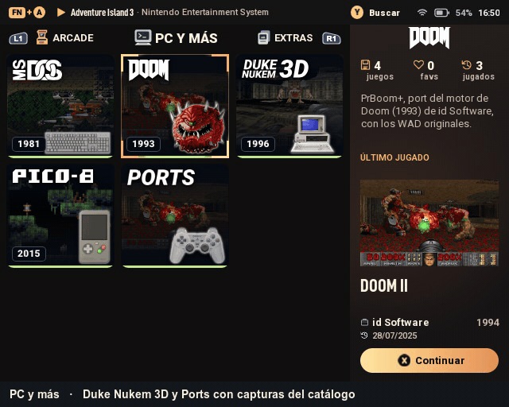

Colecciones de Extras

Últimos jugados, Todos los juegos y Sugerencias del chef comparten la ficha. Cada sugerencia identifica el juego y su consola.

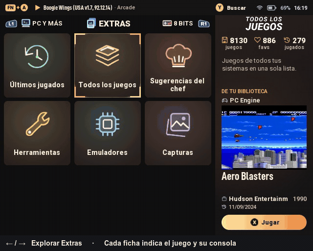

Rotación en Todos los juegos

Al terminar la vista previa, el panel presenta otro título de la colección e identifica su consola.

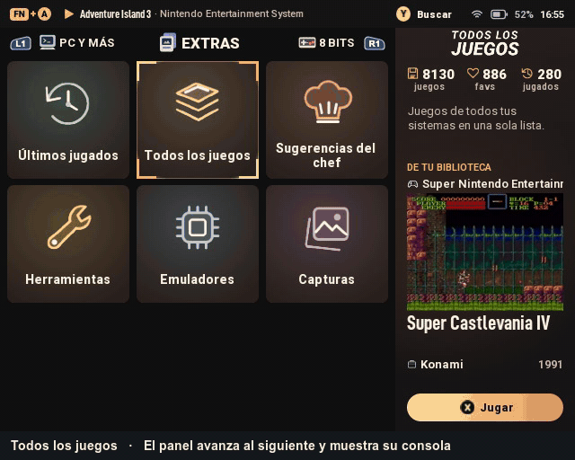

Sugerencias del chef

La ficha rota entre los juegos marcados como favoritos. En la toma pasa de Arcade a Famicom Disk System.

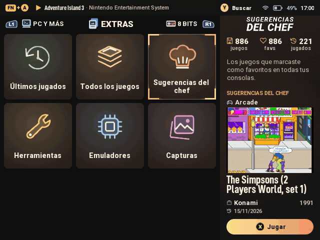

Cambio de juego al terminar el vídeo

El historial empieza por el título más reciente. Las colecciones de sugerencias eligen en otro orden.

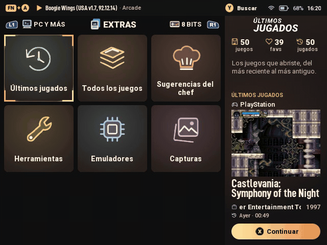

## Tarjetas y navegación

Vídeo y marcadores

Detén el foco en un juego con vídeo. El título y las insignias se atenúan mientras se reproduce.

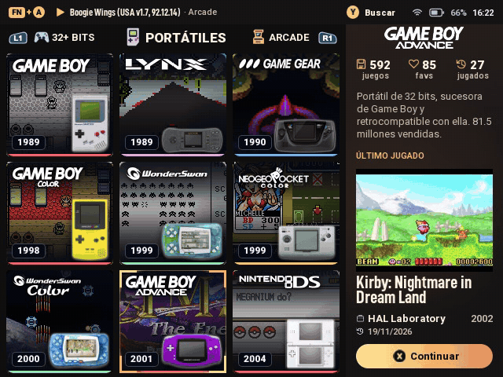

Vídeo vertical en Arcade TATE

En Battle Garegga se ve la transición de captura a vídeo en la tarjeta seleccionada.

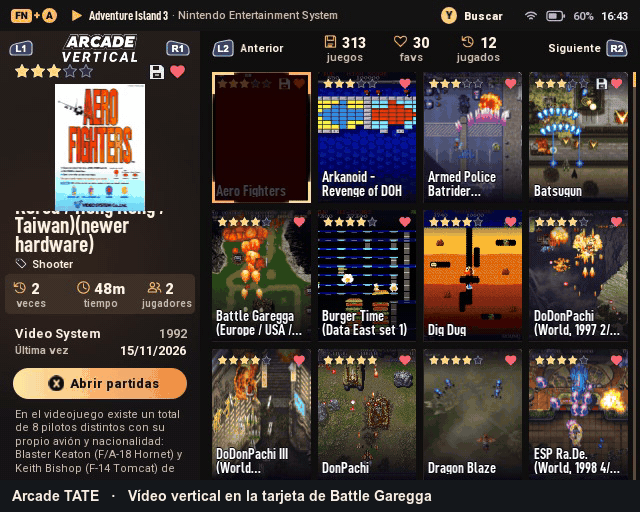

Cambiar de consola o de página

L1 y R1 recorren las consolas. L2 y R2 pasan la página.

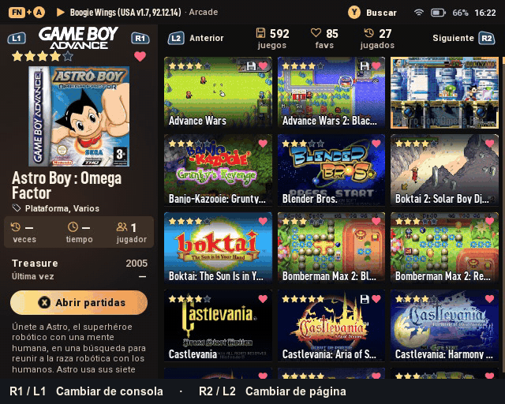

Saltar por inicial

Mantén L2 o R2 en una lista ordenada por nombre.

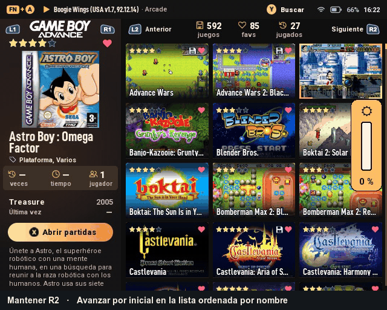

PICO-8 en tres columnas

Con el tamaño de cuadrícula en Automático, los cartuchos se ven en tres columnas.

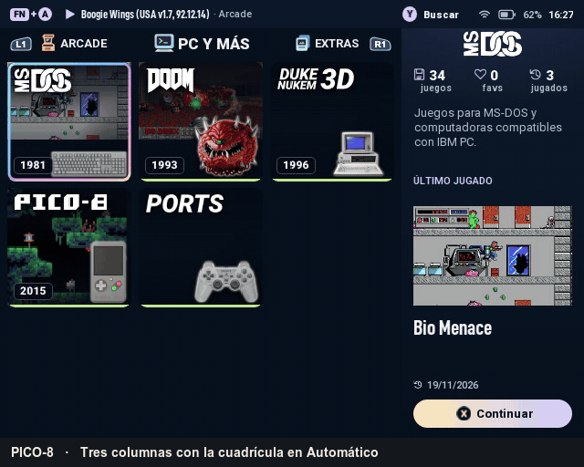

Escribir y completar palabras

Pulsa Y para buscar. L2 inserta la primera propuesta. R2 enfoca las propuestas, la cruceta elige y A inserta. START aplica el filtro.

Añadir a favoritos

Mantén A y elige la opción de favoritos. El corazón y el contador reflejan el cambio.

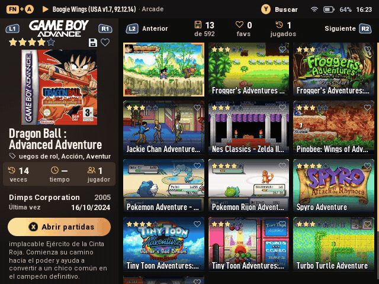

## Jugar y continuar

Iniciar un juego con A

Ascent arranca desde la cuadrícula. Se ha recortado la espera entre el menú y el juego.

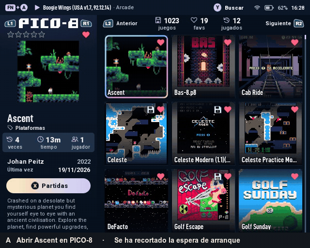

Elegir una ranura con X

Pulsa X para abrir Partidas. Cada ranura muestra la captura a todo lo ancho y su fecha y hora dentro de la tarjeta.

Retomar Adventure Island III con A

Este autoguardado abre la selección de objetos de Oak Forest, área 1-3.

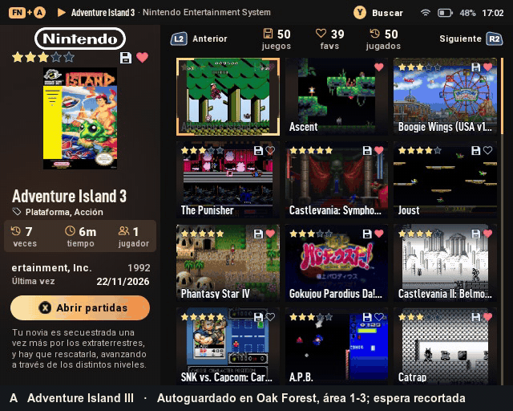

Elegir una partida anterior

Adventure Island III abre la ranura 0 elegida en Partidas, aunque el automático tiene una hora posterior.

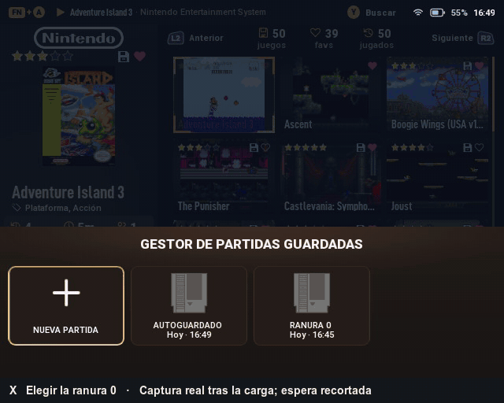

Continuar desde la ficha de consola

Al pulsar X en la ficha de Nintendo, Canica abre el juego que se ve en el panel.

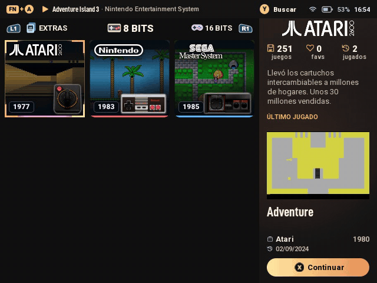

Juegos que guardan su propio avance

Cuando un sistema usa guardado interno, Partidas lo indica.

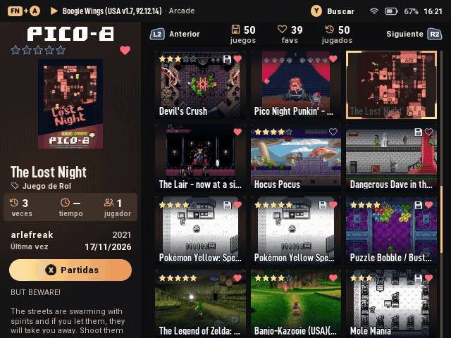

Continuar desde Inicio con FN + A

Mantén FN y pulsa A para abrir el título indicado junto al icono de reproducción.

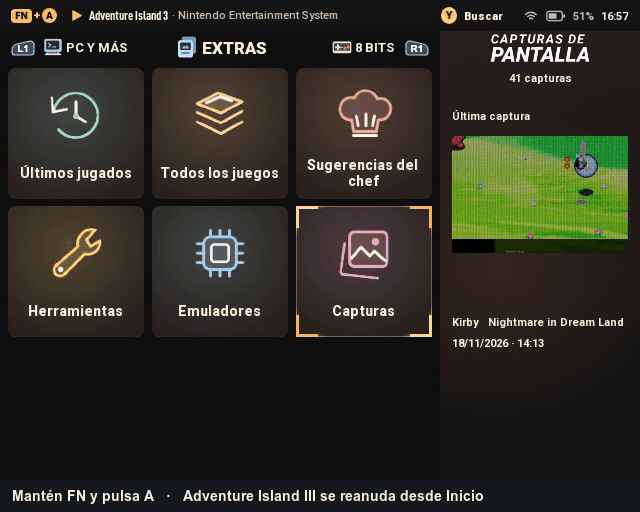

## Presentación y controles

Galería de capturas

En Extras abre Capturas. A muestra la imagen completa y la cruceta cambia de toma.

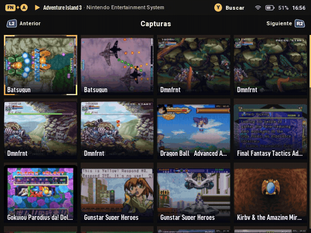

Lanzadores de Extras

Herramientas y Emuladores enumeran los accesos disponibles en la ficha. A abre su cuadrícula.

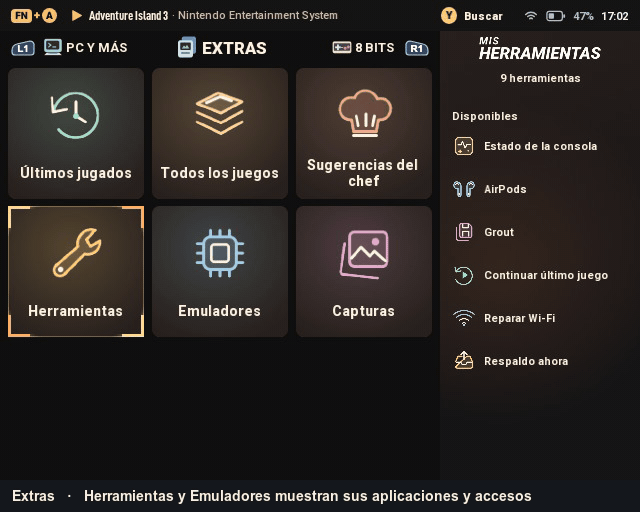

Los cinco ajustes del tema

Abre los ajustes del tema desde los ajustes de interfaz.

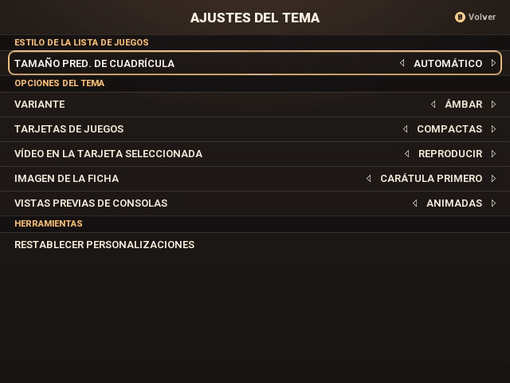

Iris y Ámbar

Las dos tomas muestran Game Boy Advance en la misma consola, con distinta variante, densidad y preferencia de vídeo.

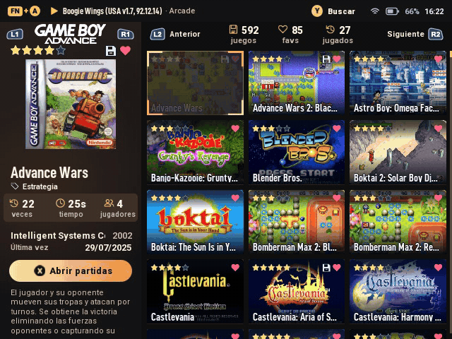

Visor a pantalla completa

Abre Visualizar los medios desde las opciones del juego. Recorre las imágenes con la cruceta.

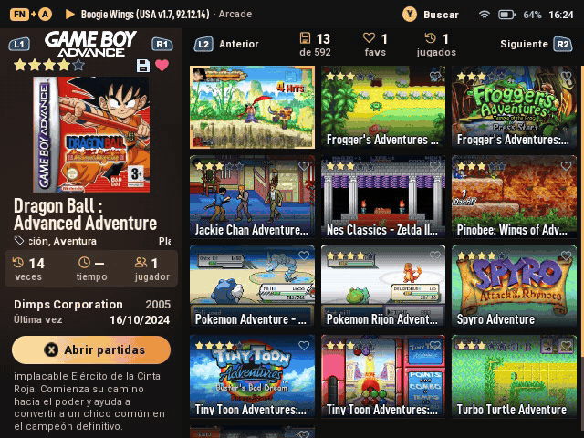

Volumen y brillo

Usa los botones de volumen. Al mantener FN, los mismos botones cambian el brillo.

