# Canica in action

[Home](../README.md) · [Install on the RG35XX H](canica-rg35xx-h.md)

Recorded on my RG35XX H. The small loops show the control in context. Open any preview for the full recording at 640 × 480. The handheld in these recordings uses Spanish.

[Browse](#browse-the-library) · [Discover](#find-the-next-game) · [Play and save](#start-a-game-or-pick-a-save) · [Customize](#make-the-handheld-your-own) · [More game cards](#four-more-game-cards)

## Browse the library

[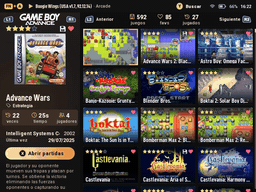](media/canica/iris-ambar.gif) [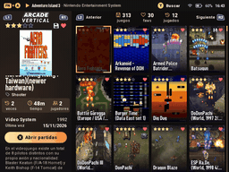](media/canica/arcade-tate.gif)

**Advance Wars in Iris and Amber.** Compare the two palettes, card sizes and video settings on Game Boy Advance. 
**Battle Garegga in portrait.** Watch the screenshot give way to a vertical arcade video inside its card.

[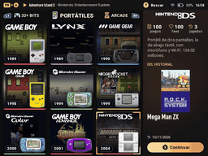](media/canica/consolas.gif) [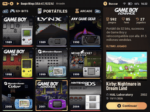](media/canica/fichas.gif)

**From Game Boy to Nintendo DS.** Browse handheld shelves, their library totals and their playing history. 
**Gameplay takes the focus.** Rest on a card with a video. The title, stars, heart and save marker fade as playback starts.

 [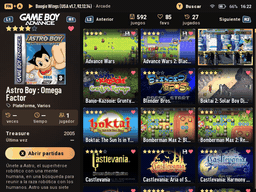](media/canica/gatillos.gif)

**Console categories.** Press L1 or R1 on Home to change categories. Press Right to focus the console cards. 
**Change systems and pages.** In a game list, L1 and R1 switch consoles. L2 and R2 turn the page.

 

**Jump by initial.** Hold L2 or R2 in a list sorted by name to jump between initials. 
**Complete words with the D-pad.** Press Y to search. L2 inserts the first suggestion. R2 focuses the row, the D-pad chooses a word and A inserts it. START applies the filter.

 

**A shelf of PICO-8 cartridges.** Automatic grid sizing keeps PICO-8 in three columns. 
**Mark a favorite.** Hold A and choose the favorite action. The heart and the library count update together.

## Find the next game

[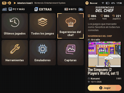](media/canica/chef.gif) [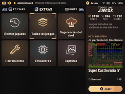](media/canica/sugerencias.gif)

**The Simpsons in Chef’s Picks.** A favorite arcade game gives way to another favorite from the Famicom Disk System. 
**All Games across systems.** The panel switches to another game when its preview ends and names the console.

[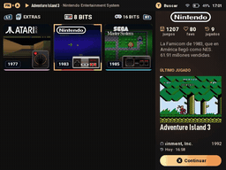](media/canica/panel-historial.gif) 

**Adventure Island III to The Punisher.** The Nintendo shelf rotates through games you have played. X launches the one in the panel. 
**Recently Played.** History starts with the most recent game and advances when the clip ends.

 

**Three collections, one panel.** Recently Played, All Games and Chef’s Picks identify both the selected game and its system. 
**Ports and Duke Nukem 3D.** Ports draws its background from the collection. Duke Nukem uses its own game art.

## Start a game or pick a save

[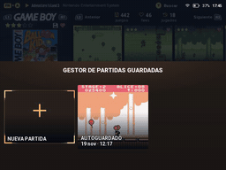](media/canica/partidas.gif) 

**Save slots at a glance.** Press X in the game list. Each slot shows its screenshot and save date. 
**Back to Oak Forest.** A resumes Adventure Island III at the item screen for area 1-3.

[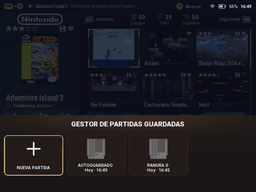](media/canica/elegir-ranura.gif) 

**Pick an earlier save.** X opens the slots. Choosing slot 0 restores that point even with a newer autosave available. 
**Resume from Home.** Hold FN and press A to launch the last game shown beside the play symbol.

 [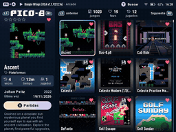](media/canica/jugar.gif)

**Continue from a console shelf.** X on the Nintendo panel launches the game it is showing. 
**Launch Ascent with A.** A starts the PICO-8 game directly. The wait between the menu and the game has been shortened in this recording.

[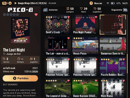](media/canica/guardado-interno.gif)

**Games with their own save system.** The slot picker explains when a system relies on saves made inside the game.

## Make the handheld your own

[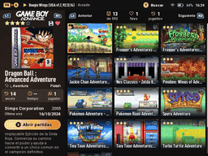](media/canica/visor.gif) 

**Dragon Ball on the fullscreen viewer.** Open the game’s media viewer and use the D-pad to browse full-size images. 
**Screenshots in Extras.** Open Screenshots, press A for the full image and use the D-pad to move between shots.

[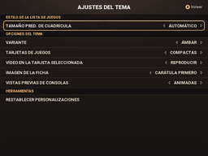](media/canica/ajustes.gif) 

**Five theme settings.** Choose a palette, card density, card video behavior, detail image and console preview behavior. 
**Volume and brightness.** The volume buttons bring up the side meter. Hold FN with the volume buttons to change brightness.

**Tools and emulators.** The side panel lists available shortcuts. Press A to open the grid.

## Four more game cards

 [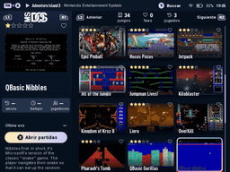](media/canica/qbasic-nibbles.gif)

**Castle Adventure · MS-DOS.** The selected card plays the DOS capture. 
**QBasic Nibbles · MS-DOS.** Watch the snake move inside the selected card.

 

**Kiloblaster · MS-DOS.** The DOS shooter runs in the preview while the library stays visible. 
**Tiny Coliseum · PICO-8.** The PICO-8 preview plays inside the square cartridge grid.
