# Canica in action

[Home](../README.md) · [Install on the RG35XX H](canica-rg35xx-h.md)

Captured on my RG35XX H with the handheld set to Spanish. **Iris is on the left, Amber on the right.** Each GIF opens independently at 640 × 480. The two runs use the same compact cards, cover art in the details panel and in-card video. The settings demo shows the other options.

[Browse](#browse-the-library) · [Discover](#find-the-next-game) · [Play and save](#start-a-game-or-pick-a-save) · [Customize](#make-the-handheld-your-own) · [More game cards](#four-more-game-cards)

## Browse the library

### Advance Wars · Game Boy Advance

<a href="media/canica/iris/iris-ambar.gif">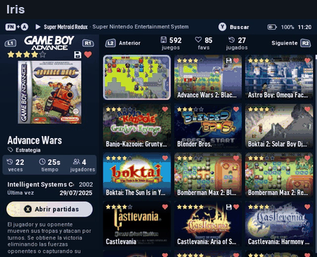</a> <a href="media/canica/ambar/iris-ambar.gif">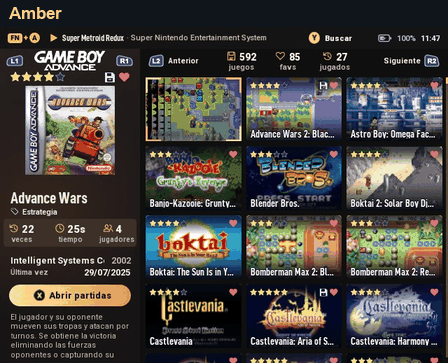</a>

The first Advance Wars gives way to Black Hole Rising and back. Both recordings use compact cards and the game box in the details panel.

### Battle Garegga in portrait

<a href="media/canica/iris/arcade-tate.gif">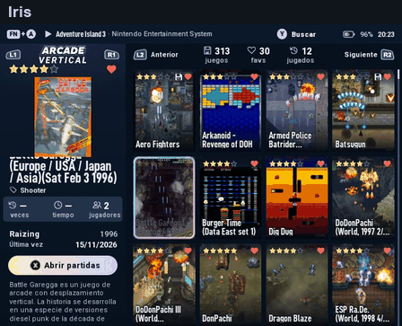</a> <a href="media/canica/ambar/arcade-tate.gif">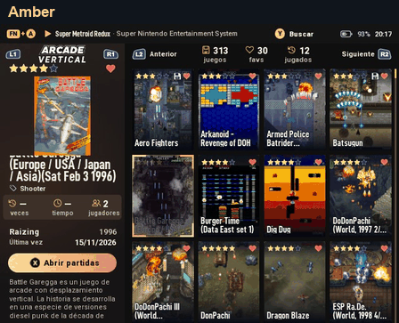</a>

Watch the screenshot give way to a vertical arcade video inside its card.

### From Game Boy to Nintendo DS

 

Browse handheld shelves, their library totals and their playing history.

### Super Metroid Redux · in-card video

 

Move the selection back to Super Metroid Redux. Watch the card markers fade as the video starts.

### Console categories

 

Press L1 or R1 on Home to change categories. Press Right to focus the console cards.

### Change systems and pages

 

In a game list, L1 and R1 switch consoles. L2 and R2 turn the page.

### Jump by initial

<a href="media/canica/iris/letras.gif">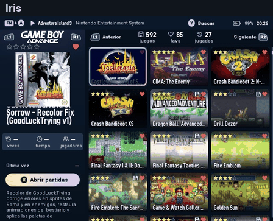</a> 

Hold L2 or R2 in a list sorted by name to jump between initials.

### Metroid · D-pad search

<a href="media/canica/iris/buscar.gif">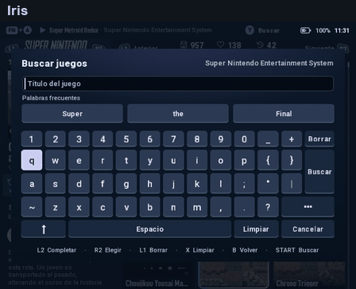</a> <a href="media/canica/ambar/buscar.gif">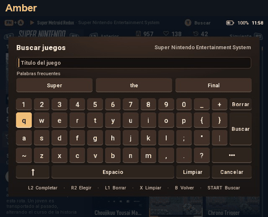</a>

Press Y and type a few letters. The keyboard offers words from the library as you type, and L2 inserts the first one. START applies the filter.

### Celeste · PICO-8

 <a href="media/canica/ambar/pico-8.gif">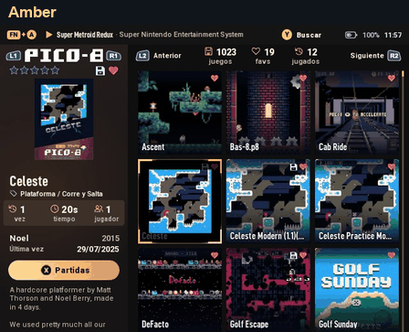</a>

Celeste appears in the three-column cartridge grid.

### Metroid Fusion · mark a favorite

<a href="media/canica/iris/favoritos.gif">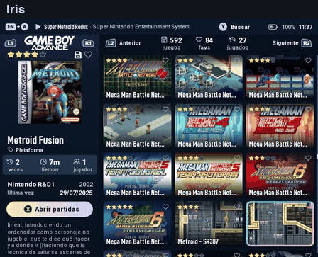</a> <a href="media/canica/ambar/favoritos.gif">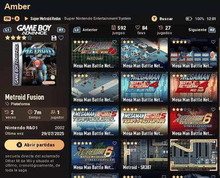</a>

Hold A and choose the favorite action. The heart and the library count update together, and the card joins the favorites at the top of the list.

## Find the next game

### Chef’s Picks

<a href="media/canica/iris/chef.gif">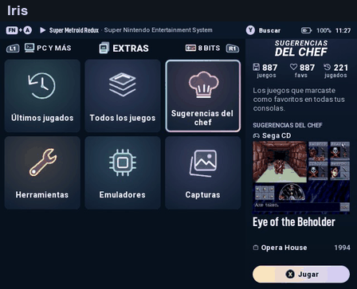</a> <a href="media/canica/ambar/chef.gif">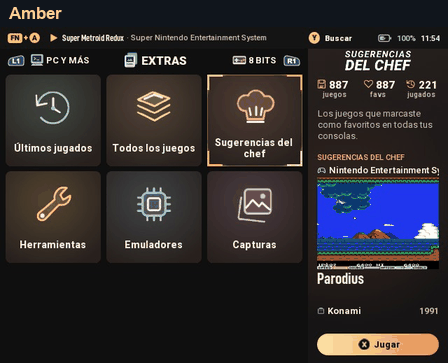</a>

The favorites panel names each game and its system as the selection changes. The picks are shuffled, so each run shows different favorites.

### All Games across systems

<a href="media/canica/iris/sugerencias.gif">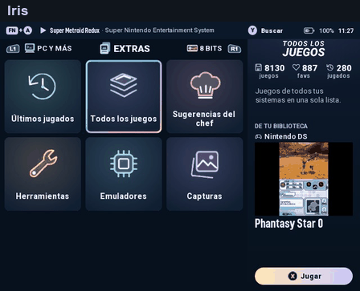</a> <a href="media/canica/ambar/sugerencias.gif">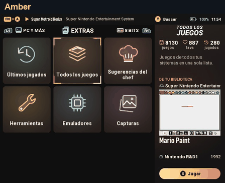</a>

The panel switches to another game when its preview ends and names the console. All Games shuffles the library, so each run shows different games.

### History on a console shelf

<a href="media/canica/iris/panel-historial.gif">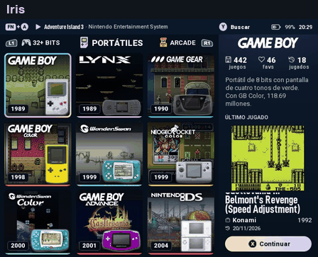</a> 

The console panel cycles through games played on that system.

### Recently Played

<a href="media/canica/iris/historial.gif">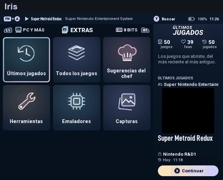</a> <a href="media/canica/ambar/historial.gif">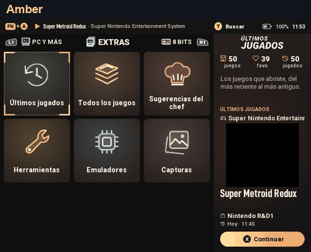</a>

History starts with the most recent game and advances when the clip ends.

### Three collections, one panel

 

Recently Played, All Games and Chef’s Picks identify both the selected game and its system. The last two are shuffled, so they differ between runs.

### Ports and Duke Nukem 3D

<a href="media/canica/iris/motores.gif">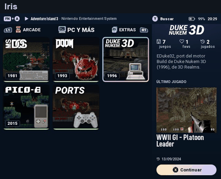</a> 

Ports draws its background from the collection. Duke Nukem uses its own game art.

## Start a game or pick a save

### Super Metroid Redux · open the save slots

 

Press X on Super Metroid Redux to see two SNES saves with different scenes, each dated September 10, 2024.

### Super Metroid Redux · resume with A

<a href="media/canica/iris/continuar-nes.gif">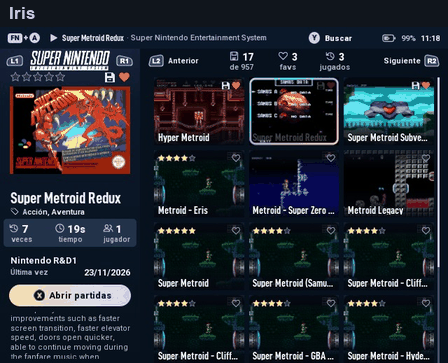</a> <a href="media/canica/ambar/continuar-nes.gif">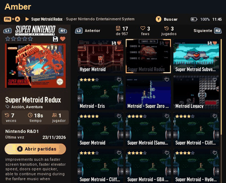</a>

Press A on the selected game to resume the most recent compatible save.

### Super Metroid Redux · compare saved scenes

 

Move between slots 0 and 1. The screenshot, slot number and save time distinguish the two saves made one minute apart.

### Super Metroid Redux · load a manual save

<a href="media/canica/iris/cargar.gif">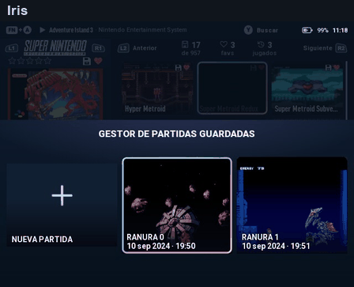</a> <a href="media/canica/ambar/cargar.gif">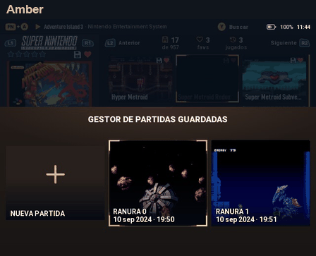</a>

Choose a dated slot with A. The emulator opens at the saved scene.

### Resume from Home

<a href="media/canica/iris/fn-a.gif">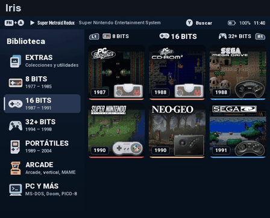</a> <a href="media/canica/ambar/fn-a.gif">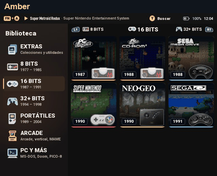</a>

Hold FN and press A to launch the last game shown beside the play symbol.

### Continue from a console shelf

<a href="media/canica/iris/panel-continuar.gif">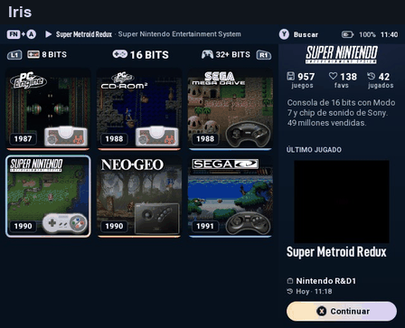</a> <a href="media/canica/ambar/panel-continuar.gif">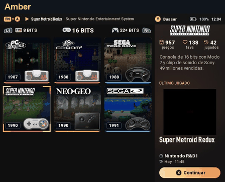</a>

X on the Super Nintendo shelf launches the game its panel is showing.

### Celeste · launch with A

<a href="media/canica/iris/jugar.gif">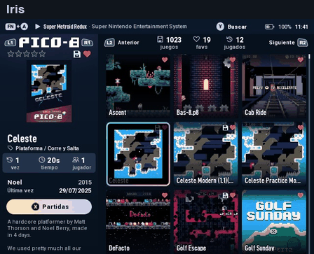</a> 

A starts the PICO-8 game directly. The wait between the menu and the game has been shortened in this recording.

### Games with their own save system

 

The slot picker explains when a system relies on saves made inside the game.

## Make the handheld your own

### Metroid Fusion · fullscreen media viewer

<a href="media/canica/iris/visor.gif">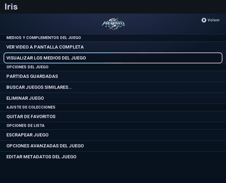</a> <a href="media/canica/ambar/visor.gif">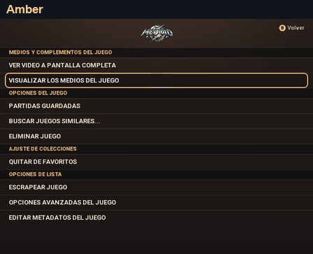</a>

Open the game’s media viewer and use the D-pad to browse full-size images.

### Screenshots in Extras

<a href="media/canica/iris/capturas.gif">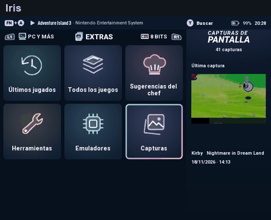</a> 

Open Screenshots, press A for the full image and use the D-pad to move between shots.

### Five theme settings

<a href="media/canica/iris/ajustes.gif">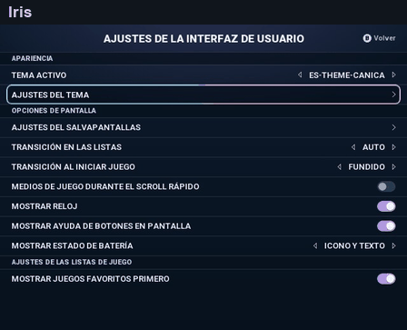</a> <a href="media/canica/ambar/ajustes.gif">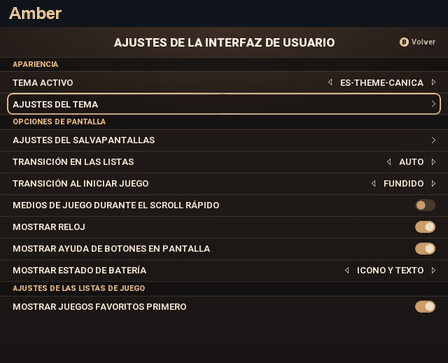</a>

Choose a palette, card density, card video behavior, detail image and console preview behavior.

### Volume and brightness

 

The volume buttons bring up the side meter. Hold FN with the volume buttons to change brightness.

### Tools and emulators

<a href="media/canica/iris/utilidades.gif">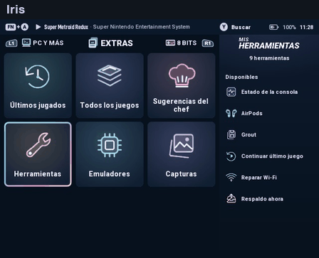</a> <a href="media/canica/ambar/utilidades.gif">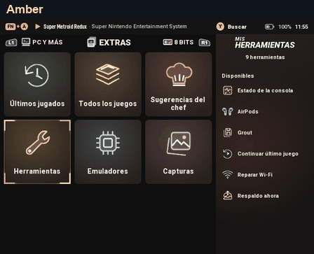</a>

The side panel lists available shortcuts. Press A to open the grid.

## Four more game cards

### Metal Slug · Neo Geo

 

The selected card plays the Neo Geo run-and-gun in the library.

### Link’s Awakening · Game Boy Color

<a href="media/canica/iris/links-awakening.gif">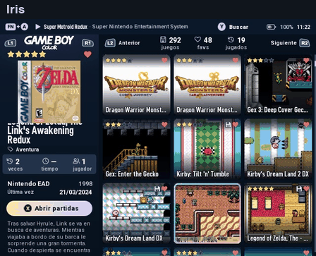</a> <a href="media/canica/ambar/links-awakening.gif">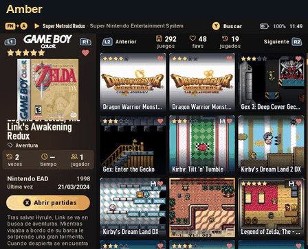</a>

Browse the handheld Zelda games and watch the selected preview.

### Chrono Trigger · Super Nintendo

<a href="media/canica/iris/chrono-trigger.gif">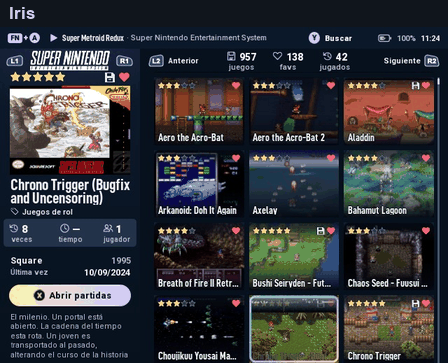</a> <a href="media/canica/ambar/chrono-trigger.gif">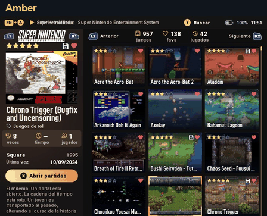</a>

Watch the selected SNES preview in the library.

### Metroid Fusion · Game Boy Advance

 

Watch the GBA game animate inside its card.

The [earlier game-card recordings](https://github.com/eduarbo/knulli-linux/blob/4f78890222a3234596b4d720ac395a2d7ca64603/docs/canica-en-accion.md#four-more-game-cards) cover Castle Adventure, QBasic Nibbles, Kiloblaster and Tiny Coliseum.
