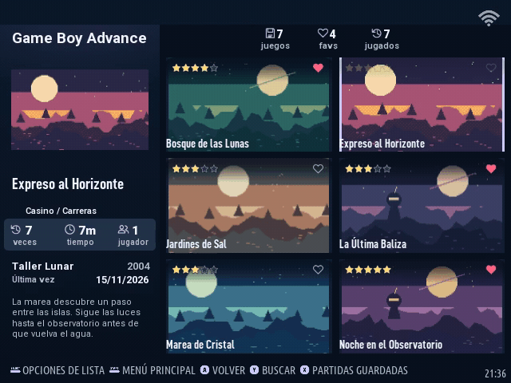

# Canica en la Anbernic RG35XX H

Canica muestra la biblioteca en tarjetas. Al recorrerlas ves la carátula, el género y tus estadísticas. Si la ficha tiene vídeo, puedes verlo sin abrir el juego. Iris y Ámbar comparten la distribución.

**Para usar el tema con el menú oficial, necesitas la RG35XX H con KNULLI Scarab del 11 de mayo de 2026 y el ZIP del tema RC28.** El ZIP visual se comparte por separado. Lo que se puede descargar públicamente de este repositorio es el instalador de la edición ampliada y su código.

## Instalar solo el tema

1. Abre la carpeta compartida `share` de la consola. En Finder usa **Ir → Conectarse al servidor** y escribe `smb://KNULLI/share`. En el Explorador de Windows escribe `\\KNULLI\share`. También puedes usar la partición de datos de la tarjeta. [Acceso por red en KNULLI](https://knulli.org/play/add-games/network-transfer/)
2. Descomprime `canica-1.0.1-rc28.zip`. Copia la carpeta **es-theme-canica** a **themes**. Desde `share` debes ver `themes/es-theme-canica/theme.xml`. Si personalizaste una carpeta con ese nombre, conserva una copia antes de sustituirla.
3. En la consola abre **START → Ajustes de la interfaz de usuario → Tema → es-theme-canica**. En **Ajustes del tema → Variante**, elige **Iris** o **Ámbar**. Para volver, selecciona tu tema anterior.

**Fondos con tus capturas.** Copia **Preparar fondos de Canica.sh** desde la carpeta del tema a `roms/tools` de `share` y ábrelo en **Herramientas**. La herramienta elige una imagen de la biblioteca para cada consola y conserva las ilustraciones originales. Vuelve a seleccionar el tema para ver los nuevos fondos. Puedes repetirlo después de añadir capturas.

| Con qué lo abres | Qué verás |
| --- | --- |
| KNULLI Scarab oficial, RG35XX H | Cuadrícula de consolas y juegos, arte de tu biblioteca, vídeos, marcadores y contadores. Las acciones disponibles aparecen en el pie del menú. |
| EmulationStation de Canica para Scarab | Se añaden categorías, salto entre consolas con L1/R1, páginas con L2/R2, búsqueda por palabras con la cruceta y selección de partidas con X. A inicia el juego. |
| EmulationStation clásico de Aloshi | Usa el ZIP **canica-clasico**. Incluye las variantes como dos temas seleccionables y una lista nativa con captura y descripción. [Vista de Ámbar en el frontend clásico](media/canica-clasico.png) |

[Ver la búsqueda por palabras del frontend ampliado](media/canica-recorrido.gif)

*Grabaciones de los frontends en escritorio ARM64, 640 × 480, con ilustraciones de muestra. Las pruebas de Scarab se hicieron en una RG35XX H con su tarjeta en uso. Sigue pendiente el primer arranque del paquete ampliado desde una microSD limpia.*

## Instalar el frontend ampliado en Scarab

Si ya tienes **Instalar Canica.sh** con el kit dentro, copia ese único archivo a `roms/tools` dentro de `share`. Si recibiste **canica-1.0.1-rc28-rg35xx-h.zip**, copia el ZIP con su nombre original, sin extraerlo, y pon el instalador público a su lado. [Descargar el instalador ligero](https://raw.githubusercontent.com/eduarbo/knulli-linux/main/tools/canica/Instalar%20Canica.sh)

Abre **Herramientas → Instalar Canica** y pulsa **A**. Si aún no aparece, usa **START → Ajustes de juegos → Actualizar listas de juegos**. Cuando indique «Canica está listo», reinicia y selecciona el tema. El kit completo de RC28 ya incluye la edición adaptable. El instalador ligero también reconoce los kits RC27.1 y RC27.2 por su nombre original.

Para volver al motor de fábrica, selecciona un tema compatible, desactiva **CANICA** en **Ajustes del sistema → Servicios** y reinicia. Los archivos instalados permanecen en la tarjeta. Si se interrumpió la instalación, abre de nuevo la herramienta. El resultado queda en `system/logs/canica-instalacion.txt` dentro de `share`. El instalador comprueba el modelo, Scarab y el motor de fábrica antes de cambiar archivos.

## EmulationStation clásico

Descomprime `canica-clasico.zip` dentro de `~/.emulationstation/themes/`. Las carpetas `canica-iris` y `canica-ambar` deben quedar directamente dentro de `themes`. Elige la variante en los ajustes de interfaz. Se comprobó el frontend original en Linux ARM64 con una biblioteca de muestra. [Versión de Aloshi probada](https://github.com/Aloshi/EmulationStation/tree/9cc42adff67946175d2b7e25c6ae69cc374e98a0)

Para preparar una tarjeta nueva, sigue las instrucciones de KNULLI y elige la imagen exacta de la RG35XX H. Para reproducir el motor desde fuentes, consulta la guía del fork. [Instalar KNULLI](https://knulli.org/play/install/) · [Imagen Scarab para RG35XX H](https://github.com/knulli-cfw/knulli-linux/releases/download/20260511/knulli-h700-rg35xx-h-scarab-20260511.img.gz) · [Compilación y recuperación](../tools/canica/README.md)
